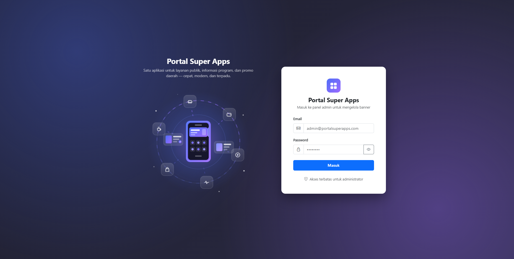

# Portal Super Apps Pemerintah Daerah

REST API dan panel admin untuk **Portal Super Apps Pemerintah Daerah** — satu aplikasi untuk layanan publik, informasi program, dan promo daerah. Aplikasi ini menyediakan pengelolaan banner utama dan banner promosi yang tampil di halaman utama portal.



## Fitur

- **Banner utama** — satu banner utama untuk halaman utama, lengkap dengan CRUD (judul, deskripsi, gambar).
- **Banner promosi** — maksimal tiga banner promosi untuk halaman utama, lengkap dengan CRUD.
- **Endpoint publik** — banner dapat dibaca tanpa autentikasi; operasi tulis (create/update/delete) wajib JWT.
- **Autentikasi JWT** — login memverifikasi akun dari tabel `users` di database (password di-hash bcrypt), bukan dari `.env`.
- **Upload gambar lokal** — hanya JPG/PNG, maksimal 2 MB, dengan validasi signature file.
- **Halaman login modern** — ilustrasi vektor animasi (inline SVG + CSS), mobile-first.
- **Dashboard admin** — kelola banner utama dan promosi dengan Bootstrap 5.
- **Migration & seeder** — skema database terkelola dan akun admin awal dibuat otomatis.

## Teknologi

- Node.js + Express 5 + TypeScript
- Sequelize ORM + MySQL
- EJS + Bootstrap 5 + Bootstrap Icons
- JWT (`jsonwebtoken`) + `bcryptjs`
- Multer (upload gambar)

## Prasyarat

- Node.js 20+
- MySQL 8+

## Instalasi & Menjalankan

```bash
# 1. Install dependency
npm install

# 2. Salin konfigurasi environment
copy .env.example .env        # Windows
# cp .env.example .env        # Linux/macOS

# 3. Sesuaikan kredensial database, JWT_SECRET, ADMIN_EMAIL, dan ADMIN_PASSWORD di .env

# 4. Buat database (jika belum ada)
#    CREATE DATABASE portalsuperapps;

# 5. Jalankan migration (tabel users, banners, migrations)
npm run migrate

# 6. Buat akun admin awal
npm run seed

# 7. Jalankan server development
npm run dev
```

Buka <http://localhost:3000/login>, lalu masuk dengan akun admin yang dibuat seeder.

## Script

| Script | Perintah | Deskripsi |
| --- | --- | --- |
| `npm run dev` | `tsx watch src/index.ts` | Menjalankan server development dengan auto-reload. Migration ikut dijalankan saat start. |
| `npm run migrate` | `tsx src/db/migrate.ts` | Menjalankan migration yang belum diterapkan. Gunakan `-- --down` untuk rollback. |
| `npm run seed` | `tsx src/db/seed.ts` | Menjalankan seeder (idempotent: akun yang sudah ada dilewati). |
| `npm run build` | `tsc` | Kompilasi/typecheck TypeScript. |

## Konfigurasi `.env`

| Variabel | Deskripsi | Default |
| --- | --- | --- |
| `PORT` | Port server | `3000` |
| `JWT_SECRET` | Secret penandatangan JWT (wajib) | — |
| `JWT_EXPIRES_IN` | Masa berlaku token | `8h` |
| `ADMIN_EMAIL` | Email akun admin awal (**hanya dipakai saat seed**) | `admin@example.com` |
| `ADMIN_PASSWORD` | Password akun admin awal (**hanya dipakai saat seed**) | `change-this-password` |
| `DB_HOST` | Host MySQL | `localhost` |
| `DB_PORT` | Port MySQL | `3306` |
| `DB_NAME` | Nama database | `portalsuperapps` |
| `DB_USER` | User MySQL | `root` |
| `DB_PASSWORD` | Password MySQL | _(kosong)_ |

> Setelah seeder dijalankan, login selalu membaca tabel `users`. Seeder tidak menimpa akun yang sudah ada — untuk mengganti password, perbarui langsung di database (hash bcrypt) atau hapus akun lalu jalankan `npm run seed` lagi.

## API

Base URL: `http://localhost:3000`

| Method | Endpoint | Auth | Deskripsi |
| --- | --- | --- | --- |
| `POST` | `/api/auth/login` | — | Login, mengembalikan `{ token }`. Body: `{ "email": "...", "password": "..." }`. |
| `GET` | `/api/auth/me` | Bearer | Mengembalikan `{ email }` dari token. |
| `GET` | `/api/banners/main` | — | Daftar banner utama (maksimal 1). |
| `GET` | `/api/banners/promotions` | — | Daftar banner promosi (maksimal 3). |
| `GET` | `/api/banners/:collection/:id` | — | Detail banner. |
| `POST` | `/api/banners/:collection` | Bearer | Tambah banner (multipart: `title`, `description`, `image`). |
| `PUT` | `/api/banners/:collection/:id` | Bearer | Ubah banner (multipart, field opsional). |
| `DELETE` | `/api/banners/:collection/:id` | Bearer | Hapus banner. |
| `GET` | `/api` | — | Info API. |

Nilai `:collection` adalah `main` atau `promotions`.

Contoh:

```bash
# Login
curl -X POST http://localhost:3000/api/auth/login \
  -H "Content-Type: application/json" \
  -d "{\"email\":\"admin@example.com\",\"password\":\"change-this-password\"}"

# Tambah banner promosi
curl -X POST http://localhost:3000/api/banners/promotions \
  -H "Authorization: Bearer <TOKEN>" \
  -F "title=Promo Akhir Tahun" \
  -F "description=Diskon layanan publik hingga 50%" \
  -F "image=@banner.png"
```

Bentuk data banner:

```json
{
  "id": "1",
  "title": "Promo Akhir Tahun",
  "description": "Diskon layanan publik hingga 50%",
  "imageUrl": "http://localhost:3000/uploads/<nama-file>.png",
  "createdAt": "2026-11-03T05:52:00.000Z",
  "updatedAt": "2026-11-03T05:52:00.000Z"
}
```

Aturan tambahan:

- Banner utama hanya boleh 1, banner promosi maksimal 3 (selain itu `409 Conflict`).
- Gambar wajib JPG/PNG valid, maksimal 2 MB (`413` jika melebihi).
- File gambar disimpan di folder `uploads/` dan disajikan melalui `/uploads/*`.

Koleksi Postman tersedia di [`postman/portal-super-apps.postman_collection.json`](postman/portal-super-apps.postman_collection.json).

## Halaman

| URL | Deskripsi |
| --- | --- |
| `/login` | Halaman login admin dengan ilustrasi vektor animasi (mobile-first). |
| `/admin` | Dashboard admin untuk mengelola banner utama dan promosi. |

## Struktur Proyek

```
.
├── src/
│   ├── index.ts            # Bootstrap Express, route auth & halaman
│   ├── routes.ts           # Endpoint banner + upload gambar
│   ├── auth.ts             # Helper JWT (token & middleware)
│   ├── banner-store.ts     # Akses data banner
│   ├── config.ts           # Konfigurasi dari environment
│   ├── database.ts         # Koneksi Sequelize
│   ├── models/             # Model Sequelize (banner, user)
│   ├── db/                 # Runner + file migration dan seeder
│   ├── views/              # Template EJS (login, admin)
│   └── public/             # Aset statis (CSS, JS)
├── uploads/                # Gambar banner yang diunggah
├── postman/                # Koleksi Postman
├── landingpage.png         # Tangkapan layar halaman login
├── agents/prd.md           # Dokumen kebutuhan produk
└── .env.example            # Contoh konfigurasi environment
```

## Skema Database

| Tabel | Keterangan |
| --- | --- |
| `users` | Akun admin: `id`, `name`, `email` (unik), `password` (bcrypt), timestamps. |
| `banners` | Banner: `id`, `collection` (`main`/`promotion`), `title`, `description`, `image_url`, timestamps. |
| `migrations` | Riwayat migration yang sudah diterapkan. |
